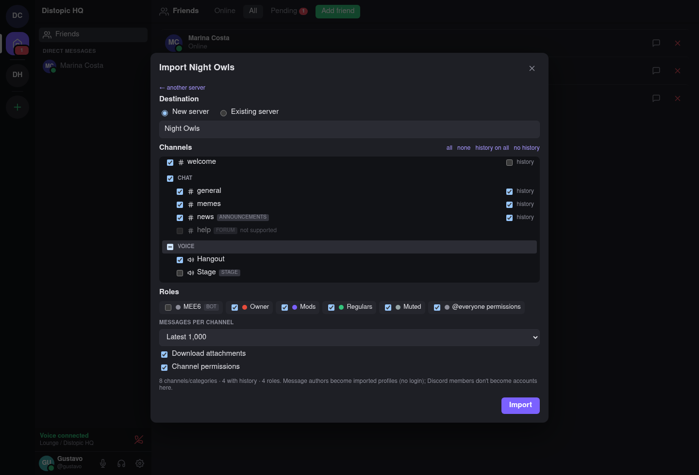

<div align="center">

# Distopic Server

**Self-hosted voice and text chat. Host it like TeamSpeak, use it like Discord.**

[](LICENSE)


**English** · [Português (Brasil)](README.pt-BR.md)

[Features](#features) · [Quick start](#quick-start) · [Configuration](#configuration) · [Discord integration](#discord-integration) · [API](#architecture) · [Client](https://github.com/GustavoHSCruz/distopic-client)


<sub>Screenshots show the English labels planned for localization; the current client UI is in Portuguese (pt-BR).</sub>

</div>

## Why Distopic?

Your community's chat should run on hardware you control. Distopic is a single
process you start on a home server, VPS or Raspberry-class machine. It has no
cloud account, telemetry or external database. You point the
[desktop client](https://github.com/GustavoHSCruz/distopic-client) at its
address and get the features people expect from Discord: servers, channels,
roles, voice, DMs and friends.

The client keeps the **official Discord one click away**, so you can move your
community gradually instead of all at once.

## Features

| Area | What you get |
| --- | --- |
| **Text** | Servers, categories, text channels, paginated history, edit/delete, replies, `@user` / `@everyone` mentions, Markdown, file attachments, typing indicators |
| **Voice** | Low-latency voice channels over WebRTC (built-in [mediasoup](https://mediasoup.org) SFU), voice activity or push-to-talk, mute/deafen, speaking indicators, server mute and disconnect for moderators |
| **Permissions** | Role hierarchy, 15 permissions, per-channel allow/inherit/deny overwrites for roles and members, invites with expiry and use limits, kick and ban |
| **Social** | Friends (requests and accept), presence, direct messages |
| **Discord import** | Copy channels, categories, roles, permission overwrites and message history (with attachments) from a Discord server. You choose exactly what comes over |
| **Sign in with Discord** | Official OAuth2 (`identify`), pulling username, display name and avatar. Imported message authors are claimed automatically |
| **Ops** | One process, SQLite storage, single UDP/TCP media port, Docker image, no external services |

## Quick start

> **Only the host runs this.** One person sets up the server, once. Everyone
> else just installs the [client](https://github.com/GustavoHSCruz/distopic-client)
> and joins with the server address and an invite code, like a TeamSpeak server.

### Docker (recommended)

```bash
git clone https://github.com/GustavoHSCruz/distopic-server.git
cd distopic-server
DISTOPIC_ANNOUNCED_IP=203.0.113.10 docker compose up -d
```

Replace `203.0.113.10` with the address clients use to reach the machine: your
LAN IP for home use, or the public IP on the internet. Open these ports:

| Port | Protocol | Purpose |
| --- | --- | --- |
| `8787` | TCP | REST API and WebSocket gateway |
| `40000` | **UDP and TCP** | Voice media |

### From source

Requires Node.js 22.13 or newer.

```bash
npm install
npm run dev      # watch mode
npm start        # production
```

Then open the [Distopic client](https://github.com/GustavoHSCruz/distopic-client),
choose **Conectar a um servidor Distopic** (Connect to a Distopic server), type the address (port `8787` is the
default) and create an account. The first person creates a server and shares
an invite.

## Configuration

All settings are environment variables. See [`.env.example`](.env.example).

| Variable | Default | Description |
| --- | --- | --- |
| `DISTOPIC_NAME` | `Distopic` | Instance name shown in the client |
| `DISTOPIC_HOST` | `0.0.0.0` | Bind address |
| `DISTOPIC_PORT` | `8787` | API and gateway port |
| `DISTOPIC_VOICE_PORT` | `40000` | Voice media port (UDP and TCP) |
| `DISTOPIC_ANNOUNCED_IP` | default-route IP | Address advertised to voice clients. **Set the public IP on the internet; required in Docker** |
| `DISTOPIC_REGISTRATION` | `open` | `closed` disables new sign-ups |
| `DISTOPIC_MAX_UPLOAD_MB` | `25` | Maximum size per attachment |
| `DISTOPIC_DATA_DIR` | `./data` | SQLite database and attachments |
| `DISTOPIC_DISCORD_CLIENT_ID` | (empty) | Enables "Sign in with Discord" (with the secret) |
| `DISTOPIC_DISCORD_CLIENT_SECRET` | (empty) | Discord OAuth2 client secret |
| `DISTOPIC_PUBLIC_URL` | request origin | Public origin for OAuth redirects behind a proxy |

The API speaks plain HTTP. For internet exposure, put a TLS reverse proxy (Caddy,
nginx, Cloudflare Tunnel) in front of port `8787` and connect with
`https://your.domain`. Voice media is already encrypted (DTLS-SRTP).

**Backups:** copy `DISTOPIC_DATA_DIR`. It holds `distopic.db` (SQLite, WAL mode) and
`uploads/`.

## Discord integration

Distopic never uses your personal Discord session. Both features below use
Discord's **official, documented APIs**, so they don't put accounts at risk.

### Importing a Discord server



1. In the [Discord Developer Portal](https://discord.com/developers/applications),
   create an application and open **Bot**. Enable **Message Content Intent**,
   then copy the token.
2. In the client, open **+ → Importar do Discord** (the UI is in Portuguese for now) and paste the token. The wizard gives
   you an invite link that adds the bot with read-only access (View Channels and
   Read Message History).
3. Pick the server, then choose the channels, which of them keep their history,
   how many messages to copy (100, 1k, 10k or everything), roles, per-channel
   permissions and attachments. Import into a new server or one you own.

What is preserved: channel order and categories, role names, colours and
hierarchy, permission mapping, message dates, replies, and mentions rendered as
text. Each message author becomes an *imported profile* (name and avatar, no
login).

What is not: Discord members don't become accounts, so member-specific
overwrites and DMs are skipped. Forums, threads, custom emoji and stickers are
not imported. The bot token is used only during the import and is never stored.

### Sign in with Discord

1. Use the same Developer Portal application. Under **OAuth2 → Redirects**, add
   `https://your.domain/api/auth/discord/callback`, matching the address clients
   connect to.
2. Set `DISTOPIC_DISCORD_CLIENT_ID` and `DISTOPIC_DISCORD_CLIENT_SECRET`.

Users get a **Sign in with Discord** button. Existing accounts can link Discord
in Settings, which also refreshes their name and avatar later. If someone's
messages were imported earlier, signing in makes those messages theirs.

## Architecture

```
packages/protocol   wire contract shared with the client: entities, gateway events, permissions
src/
  index.ts          Fastify bootstrap: REST under /api, WebSocket gateway at /gateway
  db.ts             SQLite schema (node:sqlite) and additive migrations
  perms.ts          permission resolution and role hierarchy (the authority)
  events.ts         connection registry and permission-aware event fan-out
  voice.ts          mediasoup SFU: one router per voice channel, single WebRTC port
  routes/           auth, servers, channels/messages, social, import, Discord auth
  discord/          Discord adapters: REST client, importer, OAuth2
```

The server is the single authority for permissions. The client runs the same
`computePermissions` from `packages/protocol`, but only to decide which controls
to show. The protocol package is owned by this repository. The client vendors a
copy and syncs it with `npm run sync:protocol`.

## Roadmap

- [ ] English UI and localization in the client
- [ ] Global push-to-talk hotkey in the client
- [ ] Video and screen sharing in voice channels
- [ ] Custom avatars and server icons
- [ ] API rate limiting
- [ ] Packaged client builds (AppImage, Windows, macOS)

## Contributing

Issues and pull requests are welcome. Before opening a PR, run:

```bash
npm run typecheck
```

Please describe behaviour changes and how you tested them, including real voice
tests when you touch `voice.ts`.

## License

[MIT](LICENSE) © Gustavo Cruz

Distopic is not affiliated with or endorsed by Discord Inc. or TeamSpeak Systems GmbH.
